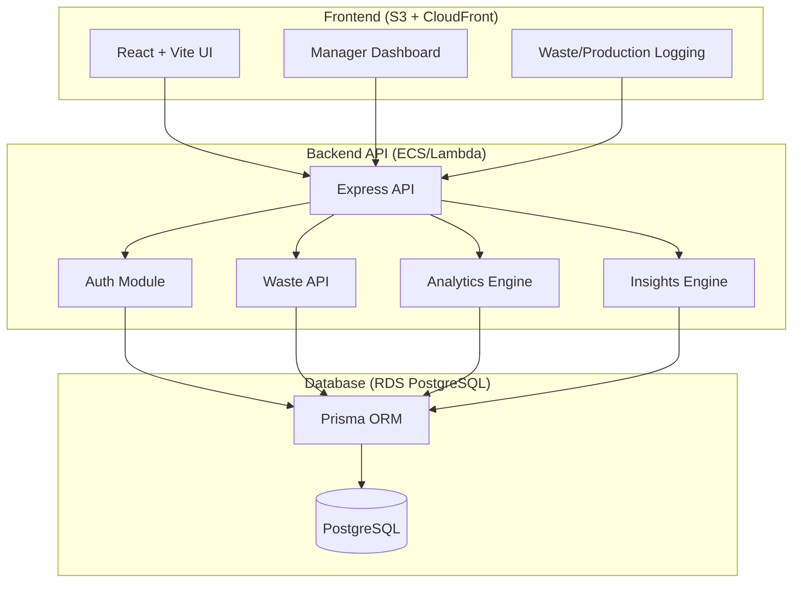

# Spec: Demo Readiness

## Overview
Prepare Maxwell Waste Tracker for demonstration with comprehensive documentation, streamlined setup, narrative-driven seed data, and a guided demo script that showcases the application's value proposition.

## Goals
1. Provide complete API documentation in OpenAPI format
2. Create clear architecture diagram using Mermaid
3. Enable one-command local environment startup
4. Seed database with compelling narrative data
5. Provide step-by-step demo script for presentations
6. Ensure documentation is clear for technical and non-technical audiences

---

## Requirements (EARS Format)

### OpenAPI Documentation

#### R1: OpenAPI Specification File
**THE SYSTEM SHALL** provide an OpenAPI 3.0 specification file at `docs/openapi.yaml` that:
- Documents all implemented API endpoints
- Includes request/response schemas for all endpoints
- Documents authentication requirements (JWT cookie)
- Includes example requests and responses
- Documents all error responses (400, 401, 403, 404, 409, 500)
- Groups endpoints by tags: Auth, Stations, Items, Waste, Production, Analytics, Insights
- Includes server configuration for local and production environments
- Uses Zod schema definitions converted to JSON Schema where applicable

#### R2: OpenAPI Endpoint Documentation Coverage
**THE SYSTEM SHALL** document the following endpoints in OpenAPI:

**Authentication:**
- POST /api/auth/login
- POST /api/auth/logout
- GET /api/auth/me

**Stations (Public):**
- GET /api/stations
- GET /api/stations/:id
- GET /api/stations/:id/items

**Admin - Stations:**
- POST /api/admin/stations
- PATCH /api/admin/stations/:id
- DELETE /api/admin/stations/:id

**Admin - Items:**
- POST /api/admin/items
- PATCH /api/admin/items/:id
- DELETE /api/admin/items/:id
- GET /api/admin/items

**Waste Logging:**
- POST /api/waste
- GET /api/waste
- GET /api/waste/:id
- DELETE /api/waste/:id

**Production Logging:**
- POST /api/production
- GET /api/production
- GET /api/production/:id
- DELETE /api/production/:id

**Analytics:**
- GET /api/analytics/waste/summary
- GET /api/analytics/waste/by-station
- GET /api/analytics/waste/by-hour
- GET /api/analytics/waste/by-reason
- GET /api/analytics/waste/top-items

**Insights:**
- GET /api/insights

**Health:**
- GET /health

#### R3: OpenAPI Schema Components
**THE SYSTEM SHALL** define reusable schemas in OpenAPI components:
- Station
- Item
- User (with sensitive fields excluded)
- WasteLog
- ProductionLog
- WasteReason (enum)
- WasteDisposition (enum)
- Role (enum)
- Insight
- ReuseOpportunity
- PaginationMetadata
- ErrorResponse

#### R4: OpenAPI Interactive Documentation
**THE SYSTEM SHALL** provide interactive API documentation:
- Include npm script `npm run docs:api` in backend package.json
- Script starts Swagger UI or Redoc server on port 8080
- Serves OpenAPI spec at `/api-docs`
- Allows "Try it out" functionality for testing endpoints
- Includes authentication configuration for JWT testing

---

### Architecture Documentation

#### R5: Architecture Diagram in README
**THE SYSTEM SHALL** include a Mermaid architecture diagram in root `README.md` showing:
- Frontend (React + Vite)
- Backend API (Node + Express)
- Database (PostgreSQL)
- Authentication flow (JWT in httpOnly cookie)
- Key data flows: Waste Logging → Analytics → Insights
- Deployment targets: AWS (S3/CloudFront, API host, RDS)

#### R6: Mermaid Diagram Structure
**THE SYSTEM SHALL** use Mermaid syntax for the architecture diagram:


#### R7: README Structure
**THE SYSTEM SHALL** create a comprehensive root README.md with sections:
1. Project title and tagline
2. Overview and problem statement
3. Architecture diagram (Mermaid)
4. Key features list
5. Tech stack
6. Prerequisites
7. Quick start (one-command setup)
8. Project structure
9. Available scripts
10. API documentation link
11. Demo instructions link
12. Contributing guidelines
13. License

---

### One-Command Setup

#### R8: Root Package.json Setup Script
**THE SYSTEM SHALL** create a root `package.json` with npm workspaces:
```json
{
  "name": "maxwell-waste-tracker",
  "version": "1.0.0",
  "private": true,
  "workspaces": [
    "frontend",
    "backend"
  ],
  "scripts": {
    "setup": "npm run docker:up && npm run backend:setup && npm run frontend:install",
    "dev": "concurrently \"npm run backend:dev\" \"npm run frontend:dev\"",
    "docker:up": "docker-compose up -d",
    "docker:down": "docker-compose down",
    "backend:setup": "cd backend && npm install && npm run db:migrate && npm run db:seed",
    "backend:dev": "cd backend && npm run dev",
    "frontend:install": "cd frontend && npm install",
    "frontend:dev": "cd frontend && npm run dev",
    "test": "npm run test --workspaces",
    "lint": "npm run lint --workspaces",
    "format": "npm run format --workspaces"
  }
}
```

#### R9: Setup Command Requirements
**THE SYSTEM SHALL** implement `npm run setup` to:
1. Start Docker containers (PostgreSQL)
2. Install backend dependencies
3. Run Prisma migrations
4. Run demo seed script
5. Install frontend dependencies
6. Display success message with next steps
7. Complete in under 3 minutes on average hardware
8. Check for prerequisites (Node 20, Docker) before starting
9. Display clear error messages if prerequisites missing
10. Exit gracefully on any error with troubleshooting hints

#### R10: Dev Command Requirements
**THE SYSTEM SHALL** implement `npm run dev` to:
- Start backend API server (port 3000)
- Start frontend dev server (port 5173)
- Run both concurrently with prefixed logs
- Display URLs for both servers
- Handle shutdown gracefully (Ctrl+C stops both)
- Use `concurrently` package for process management

#### R11: Prerequisites Check Script
**THE SYSTEM SHALL** create a `scripts/check-prerequisites.js` that:
- Checks Node.js version (>= 20.0.0)
- Checks Docker installation and daemon running
- Checks available ports (3000, 5173, 5432)
- Displays friendly error messages for missing requirements
- Returns exit code 0 if all checks pass, 1 otherwise
- Runs automatically before `npm run setup`

---

### Narrative Seed Data

#### R12: Demo Seed Script
**THE SYSTEM SHALL** create `backend/prisma/seeds/demo.seed.ts` that:
- Seeds data with a clear narrative storyline
- Uses realistic quantities and patterns
- Creates data for the last 14 days
- Generates insights that will be detected by the insights engine
- Creates compelling reuse opportunities
- Runs idempotently (can be run multiple times safely)
- Clears existing data before seeding (in development only)

#### R13: Demo Narrative: Pizza & Pasta Overproduction
**THE SYSTEM SHALL** seed data showing:
- **Station**: Pizza & Pasta
- **Item**: Penne Arrabbiata
- **Pattern**: Overproduction after 8 PM
- **Data**: 
  - Average 30 lbs produced per shift
  - 10-12 lbs wasted (35-40% waste rate)
  - 70% of waste logged after 8 PM
  - Reason: OVERPRODUCTION (dominant)
- **Expected Insights**:
  - High priority overproduction insight
  - High priority late evening spike insight
  - Medium priority dominant reason (OVERPRODUCTION) insight

#### R14: Demo Narrative: Chicken/Meat to Pizza Reuse
**THE SYSTEM SHALL** seed data showing:
- **Source Station**: Chicken/Meat
- **Source Item**: Grilled Chicken Breast
- **Pattern**: Consistent 15 lbs/week waste
- **Target Station**: Pizza & Pasta
- **Target Use**: "Chicken topping for pizzas and pasta dishes"
- **Reuse Rule**: Active rule with 0.85 confidence score
- **Expected Output**: Reuse opportunity with ~10.5 lbs/week estimated diversion

#### R15: Demo Narrative: Simply 3 Temperature Issues
**THE SYSTEM SHALL** seed data showing:
- **Station**: Simply 3
- **Items**: Grilled Chicken Breast, Steamed Rice
- **Pattern**: TEMPERATURE_ABUSE as dominant reason (55%)
- **Data**: 8 lbs/shift average waste, consistent across all hours
- **Expected Insight**: Medium priority dominant reason (TEMPERATURE_ABUSE) insight

#### R16: Demo Narrative: Cooked Vegetables Quality Issues
**THE SYSTEM SHALL** seed data showing:
- **Station**: Cooked Vegetables
- **Items**: Steamed Broccoli, Roasted Cauliflower
- **Pattern**: QUALITY issues (underseasoned, overcooked)
- **Data**: Moderate waste (18% rate), scattered throughout day
- **Expected Insight**: Low priority or no insight (below thresholds)

#### R17: Demo Users
**THE SYSTEM SHALL** seed users with:
- **Admin**: name="Admin User", pin="1111", email="admin@maxwell.edu"
- **Manager**: name="Sarah Johnson", pin="2222", email="manager@maxwell.edu"
- **Staff - Pizza & Pasta**: name="Mike Chen", pin="3333", station=Pizza & Pasta
- **Staff - Simply 3**: name="Emma Davis", pin="4444", station=Simply 3
- **Staff - Cooked Veg**: name="James Wilson", pin="5555", station=Cooked Vegetables
- **Staff - Chicken/Meat**: name="Lisa Martinez", pin="6666", station=Chicken/Meat

#### R18: Production Data for Waste Rate Calculations
**THE SYSTEM SHALL** seed production logs that:
- Cover same date range as waste logs
- Enable waste rate calculations for top items
- Show realistic production volumes (e.g., 150-300 lbs/shift for main items)
- Match waste patterns (higher production correlates with higher waste)

---

### Demo Script

#### R19: Demo Script Document
**THE SYSTEM SHALL** create `docs/DEMO.md` with:
- Executive summary (2-3 sentences)
- Target audience and use case
- Prerequisites for running demo
- Step-by-step demo flow (15-20 minutes)
- Key talking points for each step
- Expected outcomes and screenshots placeholders
- Troubleshooting common issues
- FAQ section

#### R20: Demo Script Flow Structure
**THE SYSTEM SHALL** organize the demo script in this flow:
1. **Introduction** (2 min)
   - Problem: Food waste tracking and reduction at dining facilities
   - Solution: Maxwell Waste Tracker
2. **Login and Navigation** (1 min)
   - Login as Manager (Sarah Johnson, PIN 2222)
   - Overview of dashboard
3. **KPIs and Overview** (2 min)
   - Point out total waste, average per shift
   - Stations affected
4. **Data Visualization** (3 min)
   - Station bar chart: Pizza & Pasta highest
   - Hourly chart: Evening spike visible
   - Reason donut: OVERPRODUCTION dominant
5. **Top Items Analysis** (2 min)
   - Penne Arrabbiata with 35-40% waste rate
   - Color-coded badges explanation
6. **Insights Discovery** (4 min)
   - High priority: Penne overproduction
   - High priority: Late evening spike
   - Evidence numbers and explanations
   - Recommendations review
7. **Reuse Opportunities** (3 min)
   - Chicken to Pizza reuse card
   - Estimated 10.5 lbs/week diversion
   - Food safety reminder callout
8. **Role-Based Access** (2 min)
   - Logout and login as Staff (Mike Chen, PIN 3333)
   - Show restricted access (only Pizza & Pasta visible)
9. **Wrap-up** (1 min)
   - Summary of value: visibility, insights, action
   - Next steps: questions

#### R21: Demo Talking Points
**FOR EACH** demo step, **THE SYSTEM SHALL** provide talking points including:
- Key message (1 sentence)
- Supporting details (2-3 bullets)
- What to show/click
- Expected reaction or outcome
- Transition to next step

Example for Insights section:
```markdown
### Step 6: Insights Discovery

**Key Message**: "The system automatically analyzes patterns and generates actionable recommendations."

**Talking Points**:
- "Notice the high-priority insight about Penne Arrabbiata"
- "The system detected a 35% waste rate over the last 5 shifts"
- "Evidence shows exactly what was produced vs. wasted"
- "Recommendation is specific: reduce production or improve portion control"

**Actions**:
1. Scroll to Insights panel
2. Point out priority badges
3. Expand first insight card
4. Highlight evidence numbers
5. Read recommendation aloud

**Expected Outcome**: Audience understands the system identifies problems automatically and provides specific guidance.
```

#### R22: Demo Script Troubleshooting Section
**THE SYSTEM SHALL** include troubleshooting for:
- "Dashboard shows no data" → Check date range filter
- "Insights panel is empty" → Ensure demo seed ran successfully
- "Can't login" → Verify PIN is 4 digits, check user list
- "Charts not rendering" → Check browser console, refresh page
- "API errors" → Check backend server is running, check docker containers

---

### Documentation Quality

#### R23: Code Examples in Documentation
**THE SYSTEM SHALL** include code examples for:
- Login request with curl
- Creating a waste log with curl
- Filtering analytics by station
- Response format examples for each endpoint
- Error response examples

#### R24: Environment Variables Documentation
**THE SYSTEM SHALL** document all required environment variables:
- Create `.env.example` files in both frontend and backend
- Document each variable with inline comments
- Include demo/development values
- Mark production-only variables clearly
- Reference in main README

#### R25: Screenshots and Visual Aids
**THE SYSTEM SHALL** include placeholders for:
- Dashboard screenshot in README
- Login screen in DEMO.md
- Key charts in DEMO.md
- Insights panel in DEMO.md
- Note: Actual screenshots to be added after UI implementation

---

### Validation and Testing

#### R26: Demo Seed Validation
**THE SYSTEM SHALL** validate demo seed data by:
- Running automated script to verify record counts
- Checking that insights are generated correctly
- Verifying waste rate calculations
- Ensuring reuse opportunities appear
- Script: `npm run validate:demo-data` in backend

#### R27: Demo Script Dry Run Checklist
**THE SYSTEM SHALL** include a checklist in DEMO.md for:
- ✅ Docker containers running
- ✅ Backend server started
- ✅ Frontend server started
- ✅ Database seeded with demo data
- ✅ Can login as manager
- ✅ Dashboard loads with data
- ✅ Insights panel shows 3+ insights
- ✅ Reuse opportunities visible
- ✅ Can login as staff (restricted view)
- ✅ Can export CSV

#### R28: OpenAPI Validation
**THE SYSTEM SHALL** validate OpenAPI spec:
- Use `swagger-cli validate docs/openapi.yaml` command
- Ensure all $ref references resolve
- Verify all required fields are present
- Check that examples match schemas
- Include validation in CI/CD pipeline (future)

---

### Package Scripts Summary

#### R29: Backend Package.json Scripts
**THE SYSTEM SHALL** include in `backend/package.json`:
```json
{
  "scripts": {
    "dev": "tsx watch src/index.ts",
    "build": "tsc",
    "start": "node dist/index.js",
    "test": "vitest",
    "test:coverage": "vitest --coverage",
    "lint": "eslint src --ext .ts",
    "format": "prettier --write \"src/**/*.ts\"",
    "db:migrate": "prisma migrate deploy",
    "db:migrate:dev": "prisma migrate dev",
    "db:seed": "tsx prisma/seeds/demo.seed.ts",
    "db:studio": "prisma studio",
    "db:reset": "prisma migrate reset --force",
    "validate:demo-data": "tsx scripts/validate-demo-data.ts",
    "docs:api": "redoc-cli serve docs/openapi.yaml --port 8080"
  }
}
```

#### R30: Frontend Package.json Scripts
**THE SYSTEM SHALL** include in `frontend/package.json`:
```json
{
  "scripts": {
    "dev": "vite",
    "build": "tsc && vite build",
    "preview": "vite preview",
    "test": "vitest",
    "test:ui": "vitest --ui",
    "lint": "eslint . --ext .ts,.tsx",
    "format": "prettier --write \"src/**/*.{ts,tsx}\""
  }
}
```

---

## File Structure

```
maxwell-waste-tracker/
├── README.md                          # Main readme with architecture diagram
├── package.json                       # Root package with setup scripts
├── docker-compose.yml                 # PostgreSQL container
├── .gitignore
├── docs/
│   ├── DEMO.md                        # Demo script
│   ├── openapi.yaml                   # OpenAPI specification
│   ├── CHARTER.md                     # Development conventions
│   ├── BLUEPRINT.md                   # Data model documentation
│   ├── DEVELOPMENT.md                 # Local setup guide
│   └── API.md                         # API overview (optional)
├── scripts/
│   └── check-prerequisites.js         # Prerequisites validation
├── frontend/
│   ├── package.json
│   ├── .env.example
│   └── src/
├── backend/
│   ├── package.json
│   ├── .env.example
│   ├── docs/
│   │   └── openapi.yaml (symlink to root docs/)
│   ├── prisma/
│   │   ├── schema.prisma
│   │   └── seeds/
│   │       └── demo.seed.ts
│   ├── scripts/
│   │   └── validate-demo-data.ts
│   └── src/
└── .kiro/
    ├── steering/
    └── specs/
```

---

## Success Criteria

1. ✅ `npm run setup` completes successfully in under 3 minutes
2. ✅ `npm run dev` starts both frontend and backend servers
3. ✅ OpenAPI spec validates without errors
4. ✅ Demo seed creates compelling narrative data
5. ✅ All three insights (overproduction, evening spike, dominant reason) appear
6. ✅ Reuse opportunity for Chicken → Pizza appears
7. ✅ Manager can login and see full dashboard
8. ✅ Staff can login and see restricted view
9. ✅ README architecture diagram renders correctly
10. ✅ DEMO.md script can be followed by non-technical person
11. ✅ Interactive API docs accessible at localhost:8080
12. ✅ All demo users can authenticate successfully
13. ✅ CSV export generates valid file
14. ✅ Validation script confirms demo data integrity

---

## Out of Scope

- Production deployment automation
- Continuous integration pipeline
- Performance benchmarking
- Load testing
- Security audit
- User acceptance testing guide
- Video demo recording
- Slide deck for presentations
- Multi-language documentation
- Mobile app demo

---

## Dependencies

New packages required:

**Root:**
- `concurrently` - Run multiple npm scripts simultaneously

**Backend:**
- `@redocly/cli` or `redoc-cli` - Serve OpenAPI documentation
- `swagger-cli` - Validate OpenAPI spec

Add to respective `package.json` files.

---

## Implementation Notes

### OpenAPI Tips
- Use YAML for better readability and comments
- Define common schemas in `components/schemas`
- Use `$ref` to avoid duplication
- Include realistic examples for complex objects
- Document rate limiting if implemented

### Demo Seed Strategy
- Use deterministic dates (e.g., today minus X days)
- Create clusters of patterns, not random data
- Ensure thresholds are clearly crossed (not borderline)
- Make narrative obvious from the numbers
- Include variety across stations (not all problematic)

### Demo Script Writing
- Write for someone unfamiliar with the codebase
- Use active voice and direct instructions
- Include timing estimates for pacing
- Anticipate questions and address proactively
- Keep technical jargon minimal

### README Best Practices
- Keep it scannable with clear headings
- Use badges for status indicators (optional)
- Link to detailed docs rather than duplicating content
- Include a table of contents if over 200 lines
- Update last modified date

---

## Post-Implementation Checklist

- [ ] Run `swagger-cli validate docs/openapi.yaml`
- [ ] Test `npm run setup` on clean environment
- [ ] Complete demo script dry run with timer
- [ ] Verify all demo users can login
- [ ] Check that insights appear as expected
- [ ] Verify reuse opportunity appears
- [ ] Test CSV export with demo data
- [ ] Proofread all documentation
- [ ] Add placeholder comments for screenshots
- [ ] Update README with actual installation time
- [ ] Test on Windows, macOS, Linux (if possible)
- [ ] Verify Mermaid diagram renders on GitHub

